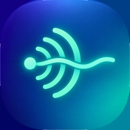
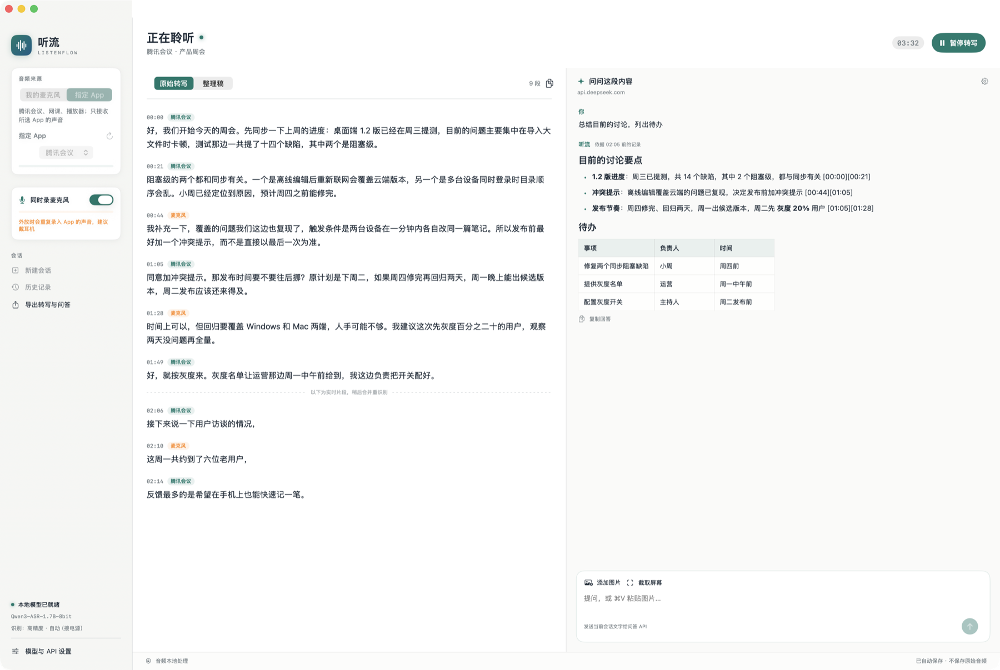
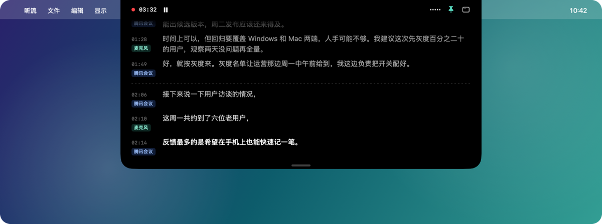
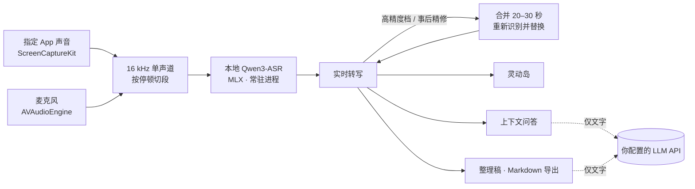

<div align="center">



# 听流 · ListenFlow

**把会议、网课和线下课堂的声音，在你自己的 Mac 上实时变成文字。**

边听边问，会后一键整理成稿。语音不出本机。

[](#安装)
[](#安装)
[](outputs/ListenFlow/Sources)
[](#它是怎么工作的)
[](https://github.com/starsalwaysineyes/listenflow/releases/latest)

[下载](https://github.com/starsalwaysineyes/listenflow/releases/latest) · [详细手册](outputs/ListenFlow/README.md) · [实测记录](outputs/ListenFlow/TESTING.md)

</div>

<br>

<p align="center">
  
</p>

<p align="center"><sub>截图中的会议内容为演示用虚构数据。</sub></p>

## 亮点

<table>
<tr>
<td width="50%" valign="top">

### 🎧 只听你选的那个 App
选中腾讯会议、浏览器或播放器，只采它的声音，系统提示音、其他窗口的视频都不会混进来。线下场景切到麦克风，也可以两路同时录，每句标出来源；外放时麦克风录到的回声会自动去掉。

</td>
<td width="50%" valign="top">

### 🔒 识别完全在本机
Qwen3-ASR 1.7B 通过 MLX 跑在 Apple Silicon 上，实时率约 0.05。音频不上传，只有你主动提问或整理时，才把**文字**发给你配置的 API。

</td>
</tr>
<tr>
<td valign="top">

### ✂️ 在停顿处切，而不是硬切
按滚动底噪判断讲话的间隙，只看 200 Hz 以上的能量，空调、风扇的低频嗡声不会让它误判。远场、低音量收音（笔记本放在教室后排）也能切得干净。

</td>
<td valign="top">

### 🔁 先出字，再变准
高精度档先实时出短片段，再把约 20 秒的内容合起来重新识别、整行替换。用电池录完也没关系，会后点「精修全文」按 30 秒一段重识别整场。

</td>
</tr>
<tr>
<td valign="top">

### 💬 边听边问，会后成稿
随时问「刚才说的截止时间是哪天」，回答带时间戳；可以截屏或粘贴图片一起问。整理稿把碎片化转写合成连贯段落，增量更新，已定稿的部分不会被改写。

</td>
<td valign="top">

### 🏝️ 刘海灵动岛
鼠标移到刘海，最近的转写从屏幕顶部展开；可以固定展开、拖动调高度、调宽度。**不会出现在屏幕共享和截图里**，共享屏幕时别人看不到你在转写什么。

</td>
</tr>
</table>

## 刘海灵动岛

<p align="center">
  
</p>

- 收起时什么都不显示，也不挡鼠标；可选「收起时常亮显示最新一句」。
- 最新一句最亮，越早越淡；虚线以下是还没合并重识别的实时片段。
- 宽度可在设置里调（480–1100 pt），14 寸、16 寸屏都合适；没有刘海的屏幕显示在顶部正中。

## 它是怎么工作的



### 实测

2224 字中文语音、带底噪，经真实 app 流程回放，统计错字数（越少越好）：

| 方案 | 有底噪 | 快语速、几乎无停顿 |
| --- | ---: | ---: |
| 早期版本：固定 4 秒硬切 | 121 | 127 |
| **省电**：在停顿处切，每段识别一次 | 72 | 90 |
| **高精度**：实时出字 + 约 20 秒合并重识别 | **58** | **59** |
| 省电录完 → **事后精修**（30 秒窗口） | 67 | 60 |

省电档约占 7.5% 的 GPU 时间，高精度约 13%。「自动」档接电源时用高精度，用电池或低电量模式时用省电。测试方法和更多数据见 [TESTING.md](outputs/ListenFlow/TESTING.md)。

## 安装

> 需要 Apple Silicon（M1 及以后）的 Mac，macOS 15 或更新。

1. **准备识别环境**并下载模型（约 2 GB）：

   ```sh
   python3.12 -m venv ~/listenflow-venv
   ~/listenflow-venv/bin/pip install mlx-audio
   ~/listenflow-venv/bin/python -c "from mlx_audio.stt.utils import load_model; load_model('mlx-community/Qwen3-ASR-1.7B-8bit')"
   ```

2. 从 [Releases](https://github.com/starsalwaysineyes/listenflow/releases/latest) 下载 zip，解压后把「ListenFlow」拖进「应用程序」。
3. 这一版没有经过 Apple 公证，第一次打开前在终端执行：

   ```sh
   xattr -dr com.apple.quarantine /Applications/ListenFlow.app
   ```

4. 打开听流 →「模型与 API 设置」，把 Python 路径填成 `~/listenflow-venv/bin/python` 的完整路径，等左下角出现「本地模型已就绪」。
5. 第一次转写时按提示允许「屏幕与系统音频录制」和「麦克风」。
6. 想用问答和整理稿，再填一个兼容 `chat/completions` 的 API（默认 DeepSeek）。只做转写可以不填。

## 使用

| 场景 | 做法 |
| --- | --- |
| 腾讯会议、网课 | 来源选「指定 App」，选中对应 App，开始转写 |
| 线下课堂、线下会议 | 来源选「我的麦克风」，`⌥⌘R` 开始 |
| 想记下板书或 PPT | `⌥⌘S` 拉框截图，`⌘K` 带着截图直接提问 |
| 会后 | 「精修全文」重识别 →「整理稿」成稿 → 导出 Markdown |

| 快捷键 | 作用 |
| --- | --- |
| `⌥⌘R` | 全局：开始 / 暂停转写 |
| `⌥⌘S` | 全局：拉框截屏，加入当前提问 |
| `⌘K` | 唤起窗口，光标进入提问框 |
| `⌘Return` | 发送问题（`Shift-Return` 换行） |
| `⌘N` / `⌘,` | 新会话 / 设置 |

关掉主窗口不会停止录音，菜单栏图标常驻，本身就是录制状态指示。

## 隐私

- **音频**：只在本机识别。「暂存录音」开启时会在本机保存 16 kHz 音频用于精修（目录权限仅本人可读），精修完成后删除，最长保留 7 天。
- **文字**：会话保存在 `~/Library/Application Support/ListenFlow/`；只有提问和整理时才发送给你配置的 API。
- **密钥**：保存在 macOS 钥匙串，不写入任何文件。
- **灵动岛**：不进入屏幕共享和截图。

## 从源码构建

```sh
git clone https://github.com/starsalwaysineyes/listenflow.git
cd listenflow/outputs/ListenFlow
./build.sh
```

只依赖系统框架（SwiftUI、ScreenCaptureKit、AVFoundation、IOKit），无第三方 Swift 包。需要 Swift Command Line Tools。测试命令见[详细手册](outputs/ListenFlow/README.md#测试)。

<details>
<summary><b>项目结构</b></summary>

```
outputs/ListenFlow/
├── Sources/
│   ├── CaptureEngine.swift     指定 App 音频 + 麦克风采集，转 16 kHz 单声道
│   ├── AudioChunker.swift      滚动底噪 + 200 Hz 高通，在停顿处切段
│   ├── Recognition.swift       识别档位、音频暂存、精修窗口与替换
│   ├── ASRBridge.swift         与 Python 识别进程的 JSON lines 管道
│   ├── NotchIsland.swift       刘海灵动岛
│   ├── LLMClient.swift         上下文快照、流式问答
│   ├── MarkdownDocument.swift  回答的 Markdown 解析与渲染
│   ├── Storage.swift           设置、钥匙串、会话与导出
│   └── AppModel.swift / ContentView.swift
├── Backend/asr_worker.py       常驻 MLX 模型
├── Tests/                      核心逻辑、Markdown、剪贴板、整理与识别进程测试
└── build.sh
work/asr-lab/                   切分与精修方案的对比实验脚本
```

</details>

## 已知限制

- 外放声音时开着麦克风，回声按文字去重（同一时段两路内容重合就只留 App 那句）；你和对方同时说话时，偶尔仍会混进对方的几个字，戴耳机最干净。
- 区分「App」和「麦克风」两路来源，不区分会议里的不同讲话人。
- 远场收音时讲话只比底噪高约 10 dB，错字仍多于近距离收音；麦克风靠近说话人最有效。
- 准确率数据来自合成语音加底噪；多人插话、背景音乐、口音等情况还需要更多实测。
- 目前只在 16 寸 M1 Max MacBook Pro 上实测过。

## 致谢

- [Qwen3-ASR](https://huggingface.co/Qwen) 与 [mlx-audio](https://github.com/Blaizzy/mlx-audio)：本地语音识别
- [Notchly](https://github.com/lglglglglg/Notchly)：刘海灵动岛的交互灵感
- [DeepSeek](https://api-docs.deepseek.com/)：默认的问答与整理接口
